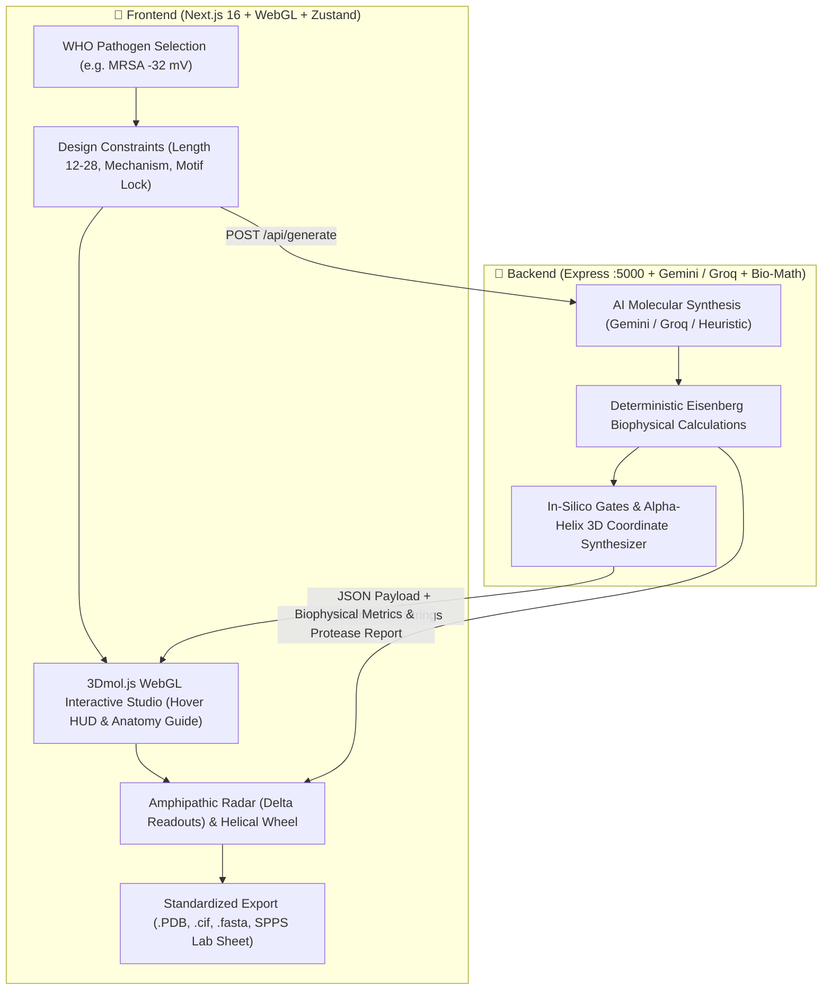

<div align="center">

# 🧬 SynthiaBio
### Autonomous Generative AI Antimicrobial Peptide (AMP) Designer & Real-Time 3D Molecular Studio

[](https://stem2connect-online-hackathon.devpost.com/)
[](https://nextjs.org/)
[](https://expressjs.com/)
[](https://ai.google.dev/)
[](https://3dmol.org/)
[](LICENSE)

<p align="center">
  <b>Tackling the WHO Critical Antimicrobial Resistance (AMR) Crisis with In-Silico Generative Drug Discovery</b>
</p>

[Devpost Submission](https://stem2connect-online-hackathon.devpost.com/) • [Handoff Notes](./docs/PAS_HANDOFF_NOTES.md) • [API Contract](./docs/API_CONTRACT.md) • [Full Blueprint](./docs/synthia-bio-master-blueprint.md)

</div>

---

## 🌍 The Global Crisis: The Superbug Tsunami

According to the **World Health Organization (WHO)**, **Antimicrobial Resistance (AMR)** is among the top 10 global public health threats facing humanity.
* Drug-resistant bacterial infections kill **1.27 million people directly** each year.
* By 2050, superbugs are projected to claim **10 million lives annually**—surpassing cancer mortality.
* Traditional small-molecule antibiotic discovery takes **10–15 years**, costs upwards of \$1.5 Billion, and faces rapid resistance adaptation by bacterial targets.

### Why Antimicrobial Peptides (AMPs)?
Unlike conventional antibiotics that inhibit specific bacterial enzymes, **Antimicrobial Peptides (AMPs)** disrupt bacterial cell membranes physically. Because the bacterial outer membrane consists of negatively charged phospholipids (phosphatidylglycerol/cardiolipin), polycationic amphipathic peptides bind electrostatically and punch physical holes (toroidal or barrel-stave pores)—making it biologically near-impossible for bacteria to develop resistance without overhauling their entire lipid synthesis pathway.

---

## ⚡ The Solution: SynthiaBio

**SynthiaBio** is an autonomous in-silico peptide engineering platform that accelerates de novo drug discovery from **years to seconds**:

1. **Target-Specific Pathogen Intelligence:** Covers 6 WHO Priority Superbugs (MRSA, *Pseudomonas aeruginosa*, *Acinetobacter baumannii*, *Klebsiella pneumoniae*, *E. coli* CRE, *Enterococcus faecium* VRE) with membrane potential and lipid ratio profiles.
2. **Generative Molecular Sequence Design:** Uses Google Gemini (`gemini-3.5-flash-lite` via `@google/genai`) and Groq (`openai/gpt-oss-120b`) with multi-candidate batch tournament screening (3x diverse candidates ranked by fitness).
3. **RFD4-Inspired In-Silico Verification Gates:** Evaluates 5 computational validation criteria: Cationic Charge Window, Erythrocyte Hemolysis Safety, Amphipathic Helical Partition, Serum Protease Stability, and Fmoc-SPPS Lab Feasibility.
4. **In-Silico Directed Evolution:** Closed-loop evolutionary optimizer proposing single-point substitutions (e.g. `E9Q`, `A5L`) with motif locking support to protect functional binding motifs.
5. **Client-Side Real-Time 3D WebGL Studio (`3Dmol.js`):** Interactive α-helix rendering (`CARTOON`, `SURFACE`, `STICK`, `SPHERE`), dynamic Eisenberg B-factor color legends (`HYDRO`, `CHARGE`, `SPECTRUM`), live residue/atom hover inspection HUD, and an on-canvas `(i)` Structure Anatomy Guide.
6. **Reactive Workspace UX:** Contextual auto-scroll and temporary `UPDATED` highlight banners, real-time biophysical metric delta readouts in radar charts, and mutated residue diff highlights.
7. **Lab-Ready Artifact Export:** Generates standardized `.PDB` 3D coordinates, mmCIF (`.cif`), FASTA records, and wet-lab Solid-Phase Peptide Synthesis (SPPS) specification sheets rendered in clean **Times New Roman** (#000000) on white paper.

---

## 📂 Modular Architecture: Clean Frontend & Backend Separation

```text
ai-hackaton/
├── 🎨 frontend/                     # Next.js 16 (App Router + Turbopack + Tailwind CSS)
│   ├── src/app/                     # Studio page layout, 100vh carbon UI & print rules
│   ├── src/components/canvas3d/     # 3Dmol.js WebGL MoleculeViewer, HUD, & Anatomy guide
│   ├── src/components/charts/       # BiophysicalRadar (with diffs), HelicalWheel, Titration
│   ├── src/components/dashboard/    # PathogenSelector, SequenceCard, Batch & Optimization panels
│   ├── src/components/export/       # SynthesisModal (Times New Roman wet-lab SPPS sheet)
│   └── src/store/usePeptideStore.ts # Central Zustand store with Express API integration
│
├── 👑 backend/                      # Node.js + Express + TypeScript Engine (:5000)
│   ├── src/ai/                      # Gemini & Groq multi-provider tournament orchestrator
│   ├── src/bio-engine/              # Eisenberg consensus calculators, PDB & mmCIF generator
│   ├── src/validators/              # Protease shield, RFD4 in-silico gates, SPPS feasibility
│   ├── src/benchmarks/              # Clinical comparison engine (Pexiganan, LL-37, Melittin)
│   └── tests/                       # 18 automated unit and HTTP integration tests
│
├── 📚 docs/                         # Documentation & Team Protocols
│   ├── PAS_HANDOFF_NOTES.md         # Comprehensive handoff notes & test scenarios for Pas
│   ├── API_CONTRACT.md              # REST API contract v1.0 specifications
│   └── synthia-bio-master-blueprint.md
└── README.md
```

---

## 🔬 Scientific Architecture & Biophysical Foundations



### 1. Net Charge ($Q$) at Physiological pH 7.4
$$Q = \sum (\text{Lys} + \text{Arg}) + 0.1 \times \text{His} - \sum (\text{Asp} + \text{Glu})$$

### 2. Mean Hydrophobicity ($\langle H \rangle$)
$$\langle H \rangle = \frac{1}{N} \sum_{i=1}^{N} H_i \quad \text{(Eisenberg Consensus Scale)}$$

### 3. Amphipathic Hydrophobic Moment ($\langle \mu_H \rangle$)
$$\langle \mu_H \rangle = \frac{1}{N} \sqrt{\left(\sum_{i=1}^N H_i \cos(i \cdot 100^\circ)\right)^2 + \left(\sum_{i=1}^N H_i \sin(i \cdot 100^\circ)\right)^2}$$

---

## 🚀 Quickstart Guide

### Prerequisites
* **Node.js 18+ LTS** and **npm**

### 1. Clone & Install
```bash
git clone https://github.com/Pashinoh/Synthia-Bio.git
cd Synthia-Bio
npm run install:all
```

### 2. Run Both Services Concurrently
```bash
npm run dev:all
```
* **Frontend:** [http://localhost:3000](http://localhost:3000)
* **Backend API:** [http://localhost:5000](http://localhost:5000) (Health status: `/health`)

### 3. Run Production Build & Automated Tests
```bash
# Run backend test suite (18 unit & HTTP tests)
npm run test:be

# Build backend and frontend
npm run build:be
npm run build

# Start production cluster
npm run start:all
```

---

## 👥 Team Structure & Roles

| Member | Domain Module | Core Ownership |
|---|---|---|
| **Irfan (Ketua)** | **`backend/src/` (`ai/`, `benchmarks/`, `gemini.ts`), Frontend Integration & UI/UX** | Express API orchestration, multi-provider AI synthesis, directed evolution, 3D interactive viewer, auto-scroll UX, and export sheets. |
| **Pas / Pashinoh** | **`backend/src/` (`bio-engine/`, `validators/`)** | Eisenberg biophysical calculators, 2D helical wheel projection, PDB & mmCIF coordinate synthesizers, protease shield validator, in-silico gates. |

---

## 📄 License
This project is open-source and distributed under the **MIT License**.  
Built with ❤️ for the global open-science and antimicrobial research community.
