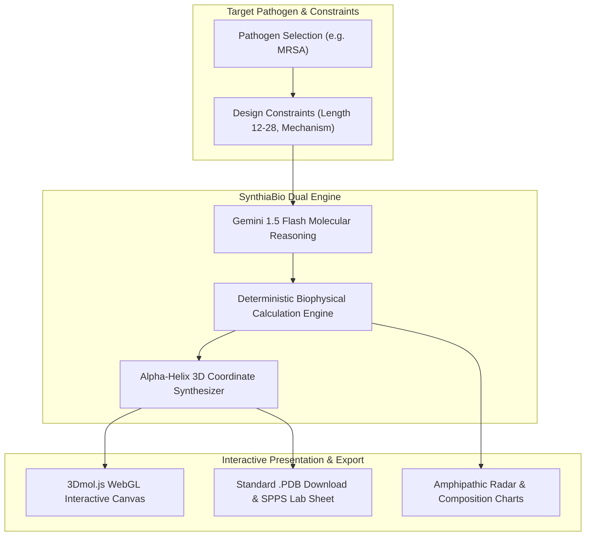

<div align="center">

# 🧬 SynthiaBio
### Autonomous Generative AI Antimicrobial Peptide (AMP) Designer & Real-Time 3D Molecular Studio

[](https://stem2connect-online-hackathon.devpost.com/)
[](https://nextjs.org/)
[](https://www.typescriptlang.org/)
[](https://ai.google.dev/)
[](https://3dmol.org/)
[](LICENSE)

<p align="center">
  <b>Tackling the WHO Critical Antimicrobial Resistance (AMR) Crisis with In-Silico Generative Drug Discovery</b>
</p>

[Live Demo](#) • [Devpost Submission](https://stem2connect-online-hackathon.devpost.com/) • [Team Workflow](./TEAM_WORKFLOW.md) • [Full Blueprint](./blueprint/synthia-bio-master-blueprint.md)

</div>

---

## 🌍 The Global Crisis: The Superbug Tsunami

According to the **World Health Organization (WHO)**, **Antimicrobial Resistance (AMR)** is among the top 10 global public health threats facing humanity.
* Drug-resistant bacterial infections kill **1.27 million people directly** each year.
* By 2050, superbugs are projected to claim **10 million lives annually**—surpassing cancer mortality.
* Traditional small-molecule antibiotic discovery takes **10–15 years**, costs upwards of \$1.5 Billion, and faces rapid resistance adaptation by bacterial targets.

### Why Antimicrobial Peptides (AMPs)?
Unlike conventional antibiotics that inhibit specific bacterial enzymes, **Antimicrobial Peptides (AMPs)** disrupt bacterial cell membranes physically. Because the bacterial outer membrane consists of negatively charged phospholipids (phosphatidylglycerol/cardiolipin), polycationic amphipathic peptides bind electrostatically and punch physical holes (toroidal or barrel-stave pores)—making it biologically near-impossible for bacteria to develop resistance without overhauling their entire lipid synthesis pathway.

---

## ⚡ The Solution: SynthiaBio

**SynthiaBio** is an autonomous in-silico peptide engineering platform that accelerates de novo drug discovery from **years to seconds**:

1. **Target-Specific Pathogen Intelligence:** Designed around WHO Critical and High Priority pathogens (MRSA, *Pseudomonas aeruginosa*, *Acinetobacter baumannii*, *Klebsiella pneumoniae*).
2. **Generative Molecular Sequence Design:** Uses Google Gemini 1.5 Flash to synthesize novel amino acid sequences optimized for specific membrane charge densities.
3. **Zero-Hallucination Biophysical Scoring:** Mathematical verification using the **Eisenberg Consensus Scale** (Net Charge, Hydrophobic Moment, Isoelectric Point, Boman Index, and Hemolysis Risk).
4. **Client-Side Real-Time 3D WebGL Studio:** Renders interactive alpha-helical ribbon conformations, electrostatic charge mappings, and hydrophobic surface envelopes directly in the browser via `3Dmol.js`—**zero GPU server overhead**.
5. **Lab-Ready Artifact Export:** Generates standardized `.PDB` 3D coordinate files, FASTA biological records, and Solid-Phase Peptide Synthesis (SPPS) laboratory protocols.

---

## 🔬 Scientific Architecture & Biophysical Foundations



### 1. Net Charge ($Q$) at Physiological pH 7.4
$$Q = \sum (\text{Lys} + \text{Arg}) + 0.1 \times \text{His} - \sum (\text{Asp} + \text{Glu})$$

### 2. Mean Hydrophobicity ($\langle H \rangle$)
$$\langle H \rangle = \frac{1}{N} \sum_{i=1}^{N} H_i \quad \text{(Eisenberg Consensus Scale)}$$

### 3. Amphipathic Hydrophobic Moment ($\langle \mu_H \rangle$)
$$\langle \mu_H \rangle = \frac{1}{N} \sqrt{\left(\sum_{i=1}^N H_i \cos(i \cdot 100^\circ)\right)^2 + \left(\sum_{i=1}^N H_i \sin(i \cdot 100^\circ)\right)^2}$$

### 4. Alpha-Helix Coordinate Synthesis ($N, C_\alpha, C, O$)
Backbone atoms are calculated analytically along an ideal cylindrical alpha-helix coordinate frame:
* Rise per residue: $\Delta z = 1.52 \text{ \AA}$
* Angular pitch per residue: $\theta = 100^\circ$ ($1.74533\text{ rad}$)
* Carbon alpha radius: $r_{C_\alpha} = 2.30 \text{ \AA}$

---

## 🛠️ Lightweight yet World-Class Tech Stack

| Layer | Technology | Key Advantage |
|---|---|---|
| **Framework** | Next.js 14+ (App Router, TS) | Unified monorepo: frontend + serverless edge API. |
| **3D Engine** | `3Dmol.js` (WebGL Native) | ~150 KB gzipped, 60 FPS in browser, **0 GPU server cost**. |
| **Styling** | Tailwind CSS v4 + Lucide Icons | Utility-first, precision biotech dark mode styling. |
| **AI Engine** | Google Gemini 1.5 Flash API | Sub-second structured JSON output with generous free tier. |
| **Biophysical Math** | Native TypeScript Engine | Runs in < 1ms on the client/edge with 0 latency. |
| **Charts** | Recharts SVG | Responsive 5-axis amphipathic potency radar chart. |
| **State** | Zustand (~1.5 KB) | Zero-boilerplate global state management. |

---

## 🚀 Getting Started

### Prerequisites
* **Node.js 18+ LTS**
* **npm** (included with Node.js)

### Installation

```bash
# 1. Clone the repository
git clone https://github.com/Pashinoh/Synthia-Bio.git
cd Synthia-Bio

# 2. Install dependencies
npm install

# 3. Configure environment variables (optional)
copy .env.example .env.local
# Add your GEMINI_API_KEY from Google AI Studio (https://aistudio.google.com/app/apikey)
# Note: If omitted, SynthiaBio gracefully falls back to verified heuristic models!

# 4. Start local development server
npm run dev

# 5. Open your browser
# Navigate to http://localhost:3000
```

---

## 👥 Team Structure & Role Division

Developed by a 2-person team for the **STEM2Connect AI Hackathon 2026**:

| Member | Role | Core Ownership |
|---|---|---|
| **Pashinoh (Ketua)** | **Tech Lead & Core AI/Bio Architect** | Gemini API prompt engineering, biophysical calculation engine, PDB 3D synthesizer, serverless API routes, Devpost technical documentation. |
| **Team Partner** | **UI/UX & 3D Frontend Lead** | Dashboard layout, 3Dmol WebGL canvas, Recharts radar charts, responsive styling, demo video production. |

See [TEAM_WORKFLOW.md](./TEAM_WORKFLOW.md) for branch strategy and collaboration protocol.

---

## 📄 License
This project is open-source and distributed under the **MIT License**.
Built with ❤️ for the global open-science and antimicrobial research community.
