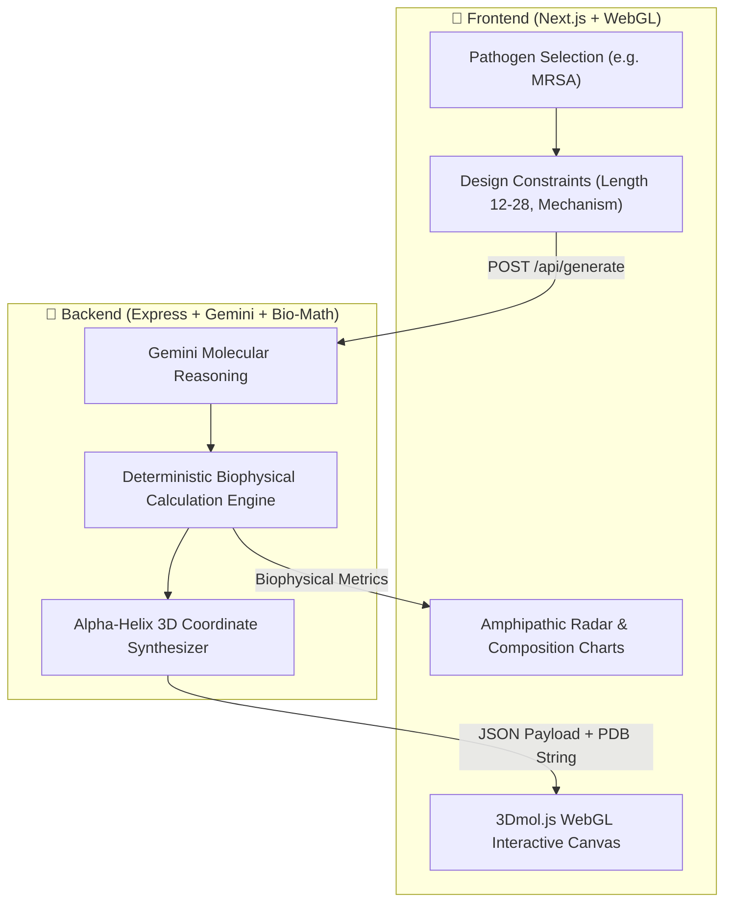

<div align="center">

# 🧬 SynthiaBio
### Autonomous Generative AI Antimicrobial Peptide (AMP) Designer & Real-Time 3D Molecular Studio

[](https://stem2connect-online-hackathon.devpost.com/)
[](https://nextjs.org/)
[](https://expressjs.com/)
[](https://ai.google.dev/)
[](https://3dmol.org/)
[](LICENSE)

<p align="center">
  <b>Tackling the WHO Critical Antimicrobial Resistance (AMR) Crisis with In-Silico Generative Drug Discovery</b>
</p>

[Devpost Submission](https://stem2connect-online-hackathon.devpost.com/) • [Team Workflow](./TEAM_WORKFLOW.md) • [Full Blueprint](./blueprint/synthia-bio-master-blueprint.md)

</div>

---

## 🌍 The Global Crisis: The Superbug Tsunami

According to the **World Health Organization (WHO)**, **Antimicrobial Resistance (AMR)** is among the top 10 global public health threats facing humanity.
* Drug-resistant bacterial infections kill **1.27 million people directly** each year.
* By 2050, superbugs are projected to claim **10 million lives annually**—surpassing cancer mortality.
* Traditional small-molecule antibiotic discovery takes **10–15 years**, costs upwards of \$1.5 Billion, and faces rapid resistance adaptation by bacterial targets.

### Why Antimicrobial Peptides (AMPs)?
Unlike conventional antibiotics that inhibit specific bacterial enzymes, **Antimicrobial Peptides (AMPs)** disrupt bacterial cell membranes physically. Because the bacterial outer membrane consists of negatively charged phospholipids (phosphatidylglycerol/cardiolipin), polycationic amphipathic peptides bind electrostatically and punch physical holes (toroidal or barrel-stave pores)—making it biologically near-impossible for bacteria to develop resistance without overhauling their entire lipid synthesis pathway.

---

## ⚡ The Solution: SynthiaBio

**SynthiaBio** is an autonomous in-silico peptide engineering platform that accelerates de novo drug discovery from **years to seconds**:

1. **Target-Specific Pathogen Intelligence:** Designed around WHO Critical and High Priority pathogens (MRSA, *Pseudomonas aeruginosa*, *Acinetobacter baumannii*, *Klebsiella pneumoniae*).
2. **Generative Molecular Sequence Design:** Uses Google Gemini (`gemini-3.5-flash-lite` via `@google/genai`) to synthesize novel amino acid sequences optimized for specific membrane charge densities.
3. **Zero-Hallucination Biophysical Scoring:** Mathematical verification using the **Eisenberg Consensus Scale** (Net Charge, Hydrophobic Moment, Isoelectric Point, Boman Index, and Hemolysis Risk).
4. **Client-Side Real-Time 3D WebGL Studio:** Renders interactive alpha-helical ribbon conformations, electrostatic charge mappings, and hydrophobic surface envelopes directly in the browser via `3Dmol.js`—**zero GPU server overhead**.
5. **Lab-Ready Artifact Export:** Generates standardized `.PDB` 3D coordinate files, FASTA biological records, and Solid-Phase Peptide Synthesis (SPPS) laboratory protocols.

---

## 📂 Modular Architecture: Clean Frontend & Backend Separation

The repository is structured into two completely independent folders so the team can work smoothly on a **single branch (`main`)** with zero merge conflicts:

```text
Synthia-Bio/
├── 🎨 frontend/                     # UI, 3D WebGL Viewer, Charts & Next.js App
│   ├── src/components/              # 3Dmol canvas, dashboard controls, radar charts
│   ├── src/app/                     # Studio page layout & styles
│   └── package.json
│
├── 👑 backend/                      # Core AI & Biophysical Math Engine
│   ├── src/server.ts                # Express API (:5000)
│   ├── src/bio-engine/              # Eisenberg calculations & PDB 3D synthesizer
│   ├── src/gemini.ts                # Google Gemini client (`@google/genai`)
│   └── package.json
│
├── blueprint/                       # 6-Pillar Master Technical Blueprint
├── TEAM_WORKFLOW.md                 # Single-branch collaboration protocol
└── README.md
```

---

## 🔬 Scientific Architecture & Biophysical Foundations



### 1. Net Charge ($Q$) at Physiological pH 7.4
$$Q = \sum (\text{Lys} + \text{Arg}) + 0.1 \times \text{His} - \sum (\text{Asp} + \text{Glu})$$

### 2. Mean Hydrophobicity ($\langle H \rangle$)
$$\langle H \rangle = \frac{1}{N} \sum_{i=1}^{N} H_i \quad \text{(Eisenberg Consensus Scale)}$$

### 3. Amphipathic Hydrophobic Moment ($\langle \mu_H \rangle$)
$$\langle \mu_H \rangle = \frac{1}{N} \sqrt{\left(\sum_{i=1}^N H_i \cos(i \cdot 100^\circ)\right)^2 + \left(\sum_{i=1}^N H_i \sin(i \cdot 100^\circ)\right)^2}$$

---

## 🚀 Quickstart Guide

### Prerequisites
* **Node.js 18+ LTS** and **npm**

### 1. Clone & Install
```bash
git clone https://github.com/Pashinoh/Synthia-Bio.git
cd Synthia-Bio
npm run install:all
```

### 2. Run Both Services Concurrently
```bash
npm run dev:all
```
* **Frontend:** [http://localhost:3000](http://localhost:3000)
* **Backend:** [http://localhost:5000](http://localhost:5000) (Health check: `/health`)

### Or Run Individually
* **Frontend only:** `npm run dev:fe` (or `cd frontend && npm run dev`)
* **Backend only:** `npm run dev:be` (or `cd backend && npm run dev`)

---

## 👥 Team Structure & Roles (Single Branch: `main`)

| Member | Domain Module (Backend-First) | Core Ownership |
|---|---|---|
| **Irfan (Ketua)** | **`backend/src/` (`ai/`, `benchmarks/`, `gemini.ts`)** | Express API orchestration, Gemini structured prompt engineering, closed-loop mutation optimizer, clinical benchmarks, Devpost submission. |
| **Pas / Pashinoh** | **`backend/src/` (`bio-engine/`, `validators/`)** | Eisenberg biophysical calculators, 2D helical wheel projection, PDB 3D coordinate synthesizer, protease degradation validator. |

---

## 📄 License
This project is open-source and distributed under the **MIT License**.  
Built with ❤️ for the global open-science and antimicrobial research community.
