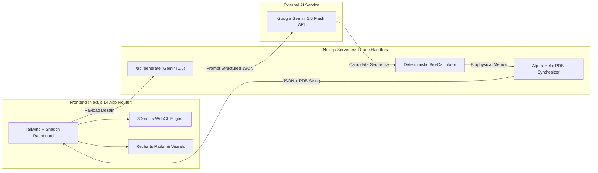
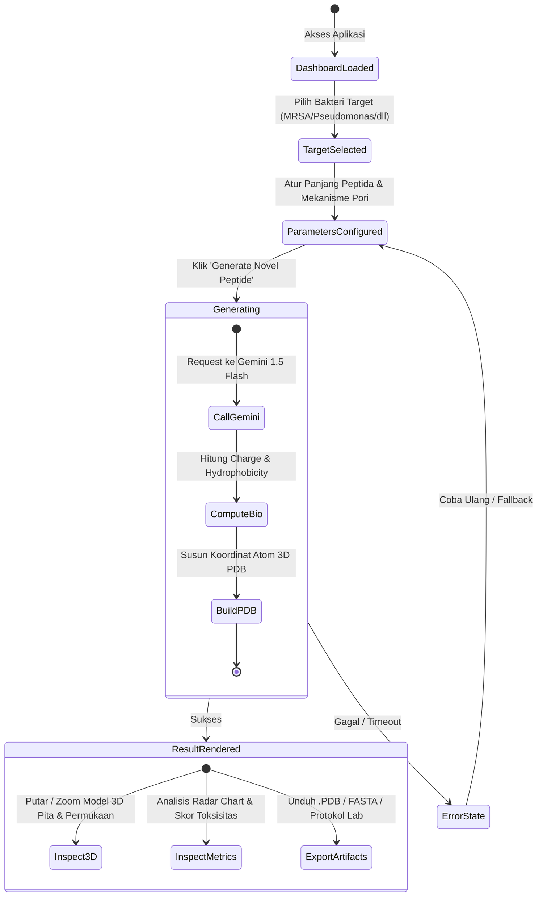

# SynthiaBio — Master Product & Engineering Blueprint
**Autonomous Generative AI Antimicrobial Peptide (AMP) Designer with Real-Time 3D Molecular Visualization**

> **Target Hackathon:** STEM2Connect AI Hackathon (Devpost)  
> **Track:** Healthcare / Scientific Research  
> **Submission Deadline:** 21 November 2026, 20:59 PST  
> **Team Size:** 2 Orang (Person 1 & Person 2)

---

## Daftar Isi
1. [PRD (Product Requirements Document)](#1-prd-product-requirements-document)
2. [TRD (Technical Requirements Document)](#2-trd-technical-requirements-document)
3. [App Flow & User Journey](#3-app-flow--user-journey)
4. [UI/UX Design Specification](#4-uiux-design-specification)
5. [Backend Schema & Data Models](#5-backend-schema--data-models)
6. [Implementation Plan & Pembagian Tugas Tim 2 Orang](#6-implementation-plan--pembagian-tugas-tim-2-orang)

---

## 1. PRD (Product Requirements Document)

### 1.1 Visi & Pernyataan Masalah
* **Masalah Kritis:** Kuman kebal antibiotik (*Superbugs / Antimicrobial Resistance*) membunuh 1.27 juta orang per tahun secara langsung dan diproyeksikan merenggut 10 juta jiwa per tahun pada 2050 (WHO). Antibiotik molekul kecil konvensional gagal karena bakteri cepat bermutasi.
* **Solusi Terobosan:** *Antimicrobial Peptides* (AMPs) membunuh bakteri secara fisik dengan melubangi membran bermuatan negatifnya (sehingga bakteri hampir mustahil mengembangkan resistensi).
* **Visi Produk:** **SynthiaBio** mendemokratisasi penemuan obat dengan memungkinkan ilmuwan, dokter, dan mahasiswa merancang kandidat peptida terapeutik baru (*de novo*) dalam hitungan detik—lengkap dengan visualisasi 3D WebGL dan verifikasi biofisika nyata.

### 1.2 Target Pengguna (User Personas)
1. **Dr. Aris (Peneliti Biologi Medis / Mahasiswa Farmasi):** Butuh kandidat molekul cepat dengan properti amfifatik dan muatan kationik yang sesuai untuk bakteri target tertentu tanpa harus menjalankan komputasi server berbayar yang rumit.
2. **Juri STEM2Connect Hackathon:** Menilai orisinalitas ide, kedalaman teknis, validitas sains (bebas halusinasi), kemudahan penggunaan, dan faktor kekaguman visual (*visual wow factor*).

### 1.3 Scope: Goals vs Non-Goals
* **Goals (Harus Dicapai dalam 10 Hari):**
  * Desain peptida *de novo* berbasis AI untuk 4 patogen prioritas kritis WHO + opsi kustom.
  * Perhitungan biofisika deterministik: Net Charge (pH 7.4), Indeks Hidrofobisitas Eisenberg, Momen Amfifatik, Boman Index, dan Estimasi Hemolisis.
  * Render molekul 3D interaktif di browser (rotasi, zoom, ganti mode pita heliks & permukaan hidrofobik).
  * Ekspor file standar `.pdb` (*Protein Data Bank*), sekuens FASTA, dan lembar protokol sintesis lab basah.
* **Non-Goals (Di Luar Cakupan Hackathon):**
  * Tidak melakukan simulasi dinamika molekuler *all-atom* 100-nanodetik (membutuhkan GPU cluster berhari-hari).
  * Tidak melakukan sintesis fisik di lab basah sungguhan.

### 1.4 Kebutuhan Fungsional (Functional Requirements)
* **FR-1 [Target Selection]:** Pengguna dapat memilih patogen (MRSA, *Pseudomonas aeruginosa*, *Acinetobacter baumannii*, *Klebsiella pneumoniae*) atau memasukkan target kustom.
* **FR-2 [Design Tuning]:** Pengguna dapat menyesuaikan panjang asam amino (12–28 aa), target mekanisme pori (*Toroidal*, *Barrel-Stave*, *Carpet*), dan toleransi toksisitas sel inang.
* **FR-3 [AI Generation]:** Sistem menghasilkan sekuens unik yang memenuhi kriteria dalam < 4 detik.
* **FR-4 [Biophysical Validation]:** Sistem menghitung dan menampilkan metrik fisikokimia nyata dalam bentuk kartu skor dan diagram radar (*Radar Chart*).
* **FR-5 [3D Molecular Canvas]:** Menampilkan struktur heliks 3D yang dapat diinteraksikan secara langsung di browser tanpa instalasi software tambahan.
* **FR-6 [Artifact Export]:** Pengguna dapat mengunduh file `.PDB`, menyalin sekuens FASTA, dan mencetak lembar protokol sintesis.

---

## 2. TRD (Technical Requirements Document)

### 2.1 Arsitektur Sistem
SynthiaBio dibangun sebagai aplikasi web modern *hybrid* (Client-Side Rendering untuk 3D WebGL dan Serverless Edge API Routes untuk orkestrasi AI):



### 2.2 Tech Stack
* **Framework:** Next.js 14+ (App Router, TypeScript)
* **Styling & Icons:** Tailwind CSS, Lucide React, Class Variance Authority (CVA)
* **3D Molecular Visualization:** `3Dmol.js` (WebGL-based, zero dependency server GPU)
* **Data Visualization:** Recharts (Radar Chart, Metric Cards)
* **AI Engine:** Google Gemini 1.5 Flash API (Structured Outputs via JSON Schema)
* **Hosting & CI/CD:** Vercel (Auto-deploy dari GitHub)

### 2.3 Formula Biofisika & Kredibilitas Ilmiah
Sistem menghitung parameter berikut secara deterministik (menghilangkan risiko halusinasi LLM):
1. **Net Charge ($Q$) pada pH 7.4:**
   $$Q = \sum (\text{Lys} + \text{Arg}) + 0.1 \times \text{His} - \sum (\text{Asp} + \text{Glu}) + 1.0 \text{ (N-term)} - 1.0 \text{ (C-term)}$$
2. **Indeks Hidrofobisitas Rata-rata ($\langle H \rangle$):**
   $$\langle H \rangle = \frac{1}{N} \sum_{i=1}^{N} H_i \quad \text{(Skala Konsensus Eisenberg)}$$
3. **Momen Hidrofobik Amfifatik ($\langle \mu_H \rangle$):**
   $$\langle \mu_H \rangle = \frac{1}{N} \sqrt{\left(\sum_{i=1}^N H_i \cos(i \cdot 100^\circ)\right)^2 + \left(\sum_{i=1}^N H_i \sin(i \cdot 100^\circ)\right)^2}$$
4. **Sintesis Koordinat 3D Heliks Alpha:**
   Menghasilkan atom $N, C_\alpha, C, O$ menggunakan kenaikan per residu $1.5\text{ \AA}$ dan rotasi per residu $100^\circ$ ke format baku PDB.

---

## 3. App Flow & User Journey

### 3.1 Diagram Alur Aplikasi



### 3.2 Skenario Interaksi Pengguna
1. **Langkah 1 (Targeting):** Pengguna membuka dashboard dan mengklik kartu patogen **"MRSA"**. Sistem otomatis mengisi data membran target (lapisan peptidoglikan tebal, membran kaya fosfatidilgliserol bermuatan negatif $-35\text{ mV}$).
2. **Langkah 2 (Refining):** Pengguna menentukan panjang sekuens (default: 18 residu) dan memilih mekanisme pori **"Toroidal Pore"**.
3. **Langkah 3 (Generating):** Pengguna menekan tombol gradien bersinar **"Synthesize Candidate"**. Indikator loading menampilkan proses bioinformatika selama ~2 detik.
4. **Langkah 4 (3D Exploration):** Canvas 3D menampilkan molekul peptida baru. Pengguna dapat:
   * Menggeser mouse untuk memutar molekul 360 derajat.
   * Menekan tombol toggle **"Hydrophobicity View"** untuk melihat pemisahan warna polar (biru) dan non-polar (oranye/merah).
   * Menekan tombol toggle **"Surface Mode"** untuk melihat kerapatan volume molekul.
5. **Langkah 5 (Exporting):** Pengguna menekan **"Download .PDB"** untuk menyimpan struktur 3D, atau **"Copy FASTA"** untuk analisis lanjutan.

---

## 4. UI/UX Design Specification

### 4.1 Desain Visual & Tema (Biotech Dark Aesthetic)
* **Background Utama:** Slate Gelap Pekat (`#090D16` / `#0B1120`)
* **Warna Aksen 1 (Primary / Action):** Cyber Cyan (`#00F0FF` / `#06B6D4`)
* **Warna Aksen 2 (Success / Bio):** Emerald Green (`#10B981`)
* **Warna Aksen 3 (Hydrophobic / Caution):** Vivid Amber (`#F59E0B`)
* **Warna Aksen 4 (Hydrophilic / Polar):** Royal Azure (`#3B82F6`)
* **Tipografi:** 
  * UI Prose: `Inter` / `Geist Sans`
  * Sekuens Biologi & Koordinat Kimia: `JetBrains Mono` / `Courier Prime`

### 4.2 Struktur Layout Dashboard (Dual-Column Desktop View)

```
+-----------------------------------------------------------------------------------+
|  [Logo] SynthiaBio  |  De Novo Peptide Studio  |  WHO AMR Priority  | [GitHub Link] |
+-----------------------------------------------------------------------------------+
| LEFT PANEL (40% Width)                   | RIGHT PANEL (60% Width)                |
|                                          |                                        |
| 1. Pathogen Selector (Grid Cards)        | 3. Interactive 3D WebGL Canvas         |
|    [ MRSA ]  [ P. aeruginosa ]           |    +--------------------------------+  |
|    [ A. baumannii ]  [ Custom ]          |    |                                |  |
|                                          |    |     [ 3D Ribbon Molecule ]     |  |
| 2. Design Constraints                    |    |      (Rotatable & Zoomable)    |  |
|    - Sequence Length: [===O===] 18 aa    |    |                                |  |
|    - Target Mechanism: Toroidal Pore     |    +--------------------------------+  |
|    - Selectivity: High (Low Hemolysis)   |    Controls: [Ribbon] [Surface] [Reset]|
|                                          |                                        |
| [  >>> GENERATE NOVEL PEPTIDE <<<  ]     | 4. Biophysical Radar & Metric Cards    |
|                                          |    [Charge: +6] [Hydro: 0.42] [Boman]  |
| 5. Candidate Sequence Card               |    +---------------+ +----------------+|
|    "KWKLFKKIEKVGQNVRDG"                  |    |  Radar Chart  | | AA Composition ||
|    [Copy FASTA]  [Download PDB]          |    +---------------+ +----------------+|
+-----------------------------------------------------------------------------------+
```

---

## 5. Backend Schema & Data Models

### 5.1 Interface TypeScript Utama

```typescript
// Profil Bakteri Target
export interface PathogenProfile {
  id: string;
  name: string;
  gramType: 'positive' | 'negative';
  whoPriority: 'Critical' | 'High';
  membraneDescription: string;
  suggestedChargeRange: [number, number]; // misal: [+4, +8]
  suggestedHydrophobicityRange: [number, number]; // misal: [0.35, 0.55]
}

// Request Payload dari Frontend ke API
export interface PeptideGenerationRequest {
  pathogenId: string;
  customPathogenName?: string;
  sequenceLength: number; // 12 - 28
  poreMechanism: 'toroidal' | 'barrel-stave' | 'carpet';
  safetyThreshold: 'high-selectivity' | 'balanced';
}

// Skema Output Gemini 1.5 (Structured JSON)
export interface GeminiPeptideOutput {
  candidateName: string;
  sequence: string; // 1-letter code, e.g. "KWKLFKKIEKVGQNVRDG"
  molecularRationale: string;
  targetBindingMechanism: string;
}

// Skor Biofisika Hasil Perhitungan Deterministik
export interface BiophysicalMetrics {
  netCharge: number; // e.g. +6.0
  meanHydrophobicity: number; // e.g. 0.42 (Eisenberg scale)
  hydrophobicMoment: number; // e.g. 0.58 (Amphipathicity)
  isoelectricPoint: number; // e.g. 10.4
  bomanIndex: number; // kcal/mol, e.g. 2.1
  predictedHemolysisRisk: 'Low' | 'Moderate' | 'High';
  therapeuticIndexScore: number; // 0 - 100
}

// Respon Lengkap API ke Frontend
export interface PeptideGenerationResponse {
  success: boolean;
  peptide: {
    name: string;
    sequence: string;
    length: number;
    rationale: string;
    mechanism: string;
    metrics: BiophysicalMetrics;
    pdbContent: string; // Teks lengkap berformat .PDB standar
    fastaContent: string;
    synthesisProtocol: {
      nTerminalMod: string; // e.g. "Free amine or Acetylated"
      cTerminalMod: string; // e.g. "Amidated (-NH2) for stability"
      purificationRecommendation: string;
    };
  };
}
```

---

## 6. Implementation Plan & Pembagian Tugas Tim 2 Orang

Untuk memastikan proyek ini selesai tepat waktu sebelum **21 November 2026** dengan kualitas juara, tugas dibagi menjadi dua peran yang terisolasi dengan kontrak data (*mock data*) yang jelas sejak Hari 1.

```
+--------------------------------------------------------------------------------+
|                             PEMBAGIAN PERAN TIM                                |
+----------------------------------------------------+---------------------------+
| PERSON 1: Frontend, 3D WebGL & Creative Lead       | PERSON 2: AI Engine, Bio  |
|                                                    | Math & Full-Stack Lead    |
| • UI Layout (Next.js 14, Tailwind, Lucide)         | • Gemini 1.5 API Prompt   |
| • 3Dmol.js WebGL Canvas & Molecule Styling         | • Formula Biofisika       |
| • Visualisasi Grafik Radar (Recharts)              | • Generator PDB 3D Atom   |
| • Responsive Design & Client Interactions          | • Next.js API Routes      |
| • Produksi Video Demo (3-4 Menit) & Slide          | • Dokumentasi Devpost &   |
|                                                    |   GitHub README           |
+----------------------------------------------------+---------------------------+
```

### 6.1 Kontrak Data Handoff (Hari 1)
Agar Person 1 tidak terhambat menunggu API Person 2 selesai:
* Person 2 membuat file `mock-peptide.json` berisi contoh respon lengkap (sekuens, metrik biofisika, dan sampel string PDB).
* Person 1 langsung membangun seluruh UI, kanvas 3D, dan chart menggunakan mock data tersebut.
* Pada Hari ke-6, Person 1 dan Person 2 cukup menghubungkan endpoint API sungguhan.

---

### 6.2 Jadwal Kerja Harian (10 Hari Sprint)

#### 📅 Hari 1–2 (11–12 Nov) — Setup Pondasi & Eksperimen 3D
* **Person 1 (Frontend):**
  * Inisialisasi Next.js 14 (App router), Tailwind CSS, dan komponen dasar.
  * Buat layout dual-panel dashboard responsif.
  * Uji coba integrasi script `3Dmol.js` di React: render satu file PDB dummy di canvas WebGL.
* **Person 2 (AI & Backend):**
  * Setup project repository GitHub, konfigurasi environment (`GEMINI_API_KEY`).
  * Tulis modul TypeScript kalkulator biofisika: tabel skala Eisenberg, formula Net Charge, dan Momen Hidrofobik.
  * Buat `mock-peptide.json` dan berikan ke Person 1.

#### 📅 Hari 3–4 (13–14 Nov) — Core Engines Development
* **Person 1 (Frontend):**
  * Bangun komponen **Pathogen Selector** (kartu interaktif MRSA, Pseudomonas, dll.).
  * Bangun kontrol interaksi 3D (tombol ganti warna muatan vs hidrofobisitas, toggle pita vs permukaan).
  * Pasang **Radar Chart** (Recharts) menggunakan data mock.
* **Person 2 (AI & Backend):**
  * Bangun algoritma **PDB Alpha-Helix Synthesizer**: fungsi matematika untuk menghasilkan string PDB atom ($N, C_\alpha, C, O$) berdasarkan sekuens asam amino.
  * Uji file PDB hasil generator di software viewer online untuk memastikan formatnya valid.
  * Buat route handler `/api/generate` terhubung ke kalkulator biofisika.

#### 📅 Hari 5–6 (15–16 Nov) — Integrasi AI Gemini & Penggabungan Sistem
* **Person 1 (Frontend):**
  * Bangun komponen State Loading & Animasi Bioinformatika saat proses generate berlangsung.
  * Bangun fitur **Export Suite** (tombol download `.pdb`, copy FASTA, modal protokol sintesis).
* **Person 2 (AI & Backend):**
  * Tulis prompt engineering biokimia untuk Google Gemini 1.5 Flash menggunakan JSON Schema resmi.
  * Sambungkan respon Gemini ke modul biofisika & PDB generator.
  * **Milestone Integrasi:** Person 1 mengganti mock data dengan pemanggilan API nyata. Sistem berjalan *end-to-end*!

#### 📅 Hari 7–8 (17–18 Nov) — Polishing, Testing & Deploy
* **Person 1 (Frontend):**
  * Polish visual micro-interactions (efek glow, dark mode accents, tooltip penjelasan metrik).
  * Uji coba kompatibilitas di browser Chrome, Firefox, Safari, dan layar mobile/tablet.
* **Person 2 (AI & Backend):**
  * Deploy aplikasi ke Vercel (pastikan environment variable aktif dan live link publik dapat diakses).
  * Buat fallback error-handling (jika quota API bermasalah, otomatis gunakan kandidat kurasi cadangan tanpa crash).
  * Susun draf teks pendaftaran Devpost dan tulis `README.md` repositori GitHub lengkap dengan diagram.

#### 📅 Hari 9–10 (19–20 Nov) — Produksi Video Demo & Finalisasi
* **Person 1 (Creative & Video):**
  * Rekam video demo aplikasi (durasi 3–4 menit) sesuai naskah di blueprint.
  * Tambahkan voiceover berbahasa Inggris yang jelas, teks judul dinamis, dan musik latar profesional.
  * Render video resolusi 1080p dan unggah ke YouTube/Vimeo.
* **Person 2 (Documentation & Submission):**
  * Lengkapi seluruh kolom formulir Devpost (*Inspiration, What it does, How we built it, Challenges, Accomplishments, Learnings, Next steps*).
  * Periksa kembali kepatuhan aturan hackathon (klausa pengungkapan penggunaan AI / *AI Disclosure*).
  * Pastikan repositori GitHub bersifat publik (*Public*) dengan lisensi open-source (MIT).

#### 📅 Hari 11 (21 Nov) — Final Review & Submission
* **Person 1 & Person 2 Bersama-sama:**
  * Lakukan *dry run* pengujian link web live di Vercel, link video YouTube, dan link GitHub.
  * Tekan tombol **Submit to STEM2Connect Hackathon** sebelum batas waktu 20:59 PST.

---

Dokumen ini adalah acuan resmi (*single source of truth*) untuk seluruh proses pengembangan SynthiaBio.
