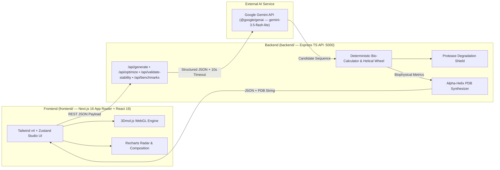
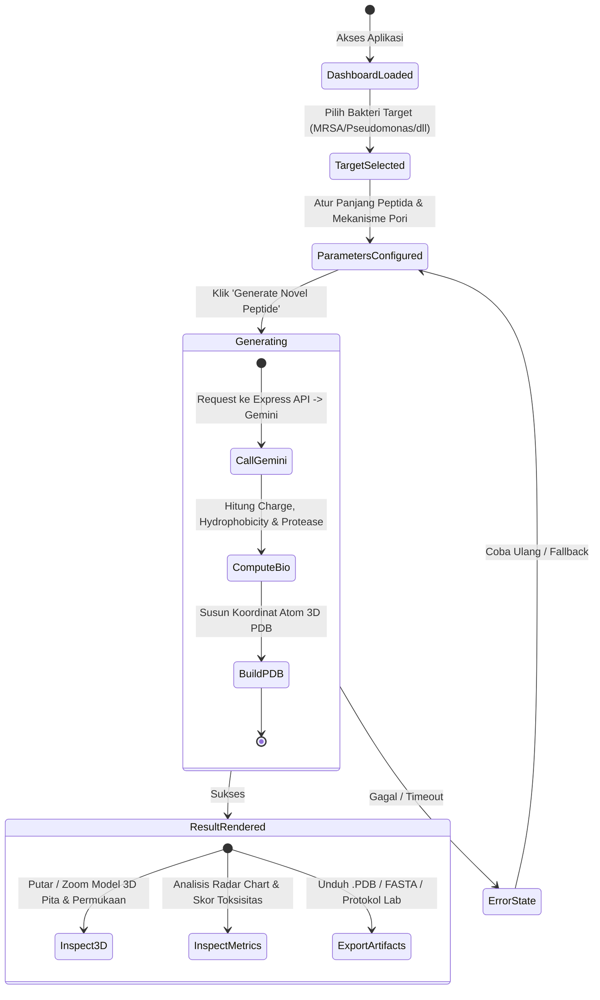

# SynthiaBio — Master Product & Engineering Blueprint
**Autonomous Generative AI Antimicrobial Peptide (AMP) Designer with Real-Time 3D Molecular Visualization**

> **Target Hackathon:** STEM2Connect AI Hackathon (Devpost)  
> **Track:** Healthcare / Scientific Research  
> **Submission Deadline:** 21 November 2026, 20:59 PST  
> **Team Size:** 2 Orang (Person 1 & Person 2)

---

## Daftar Isi
1. [PRD (Product Requirements Document)](#1-prd-product-requirements-document)
2. [TRD (Technical Requirements Document)](#2-trd-technical-requirements-document)
3. [App Flow & User Journey](#3-app-flow--user-journey)
4. [UI/UX Design Specification](#4-uiux-design-specification)
5. [Backend Schema & Data Models](#5-backend-schema--data-models)
6. [Implementation Plan & Pembagian Tugas Tim 2 Orang](#6-implementation-plan--pembagian-tugas-tim-2-orang)

---

## 1. PRD (Product Requirements Document)

### 1.1 Visi & Pernyataan Masalah
* **Masalah Kritis:** Kuman kebal antibiotik (*Superbugs / Antimicrobial Resistance*) membunuh 1.27 juta orang per tahun secara langsung dan diproyeksikan merenggut 10 juta jiwa per tahun pada 2050 (WHO). Antibiotik molekul kecil konvensional gagal karena bakteri cepat bermutasi.
* **Solusi Terobosan:** *Antimicrobial Peptides* (AMPs) membunuh bakteri secara fisik dengan melubangi membran bermuatan negatifnya (sehingga bakteri hampir mustahil mengembangkan resistensi).
* **Visi Produk:** **SynthiaBio** mendemokratisasi penemuan obat dengan memungkinkan ilmuwan, dokter, dan mahasiswa merancang kandidat peptida terapeutik baru (*de novo*) dalam hitungan detik—lengkap dengan visualisasi 3D WebGL dan verifikasi biofisika nyata.

### 1.2 Target Pengguna (User Personas)
1. **Dr. Aris (Peneliti Biologi Medis / Mahasiswa Farmasi):** Butuh kandidat molekul cepat dengan properti amfifatik dan muatan kationik yang sesuai untuk bakteri target tertentu tanpa harus menjalankan komputasi server berbayar yang rumit.
2. **Juri STEM2Connect Hackathon:** Menilai orisinalitas ide, kedalaman teknis, validitas sains (bebas halusinasi), kemudahan penggunaan, dan faktor kekaguman visual (*visual wow factor*).

### 1.3 Scope: Goals vs Non-Goals
* **Goals (Harus Dicapai dalam 10 Hari):**
  * Desain peptida *de novo* berbasis AI untuk 4 patogen prioritas kritis WHO + opsi kustom.
  * Perhitungan biofisika deterministik: Net Charge (pH 7.4), Indeks Hidrofobisitas Eisenberg, Momen Amfifatik, Boman Index, dan Estimasi Hemolisis.
  * Render molekul 3D interaktif di browser (rotasi, zoom, ganti mode pita heliks & permukaan hidrofobik).
  * Ekspor file standar `.pdb` (*Protein Data Bank*), sekuens FASTA, dan lembar protokol sintesis lab basah.
* **Non-Goals (Di Luar Cakupan Hackathon):**
  * Tidak melakukan simulasi dinamika molekuler *all-atom* 100-nanodetik (membutuhkan GPU cluster berhari-hari).
  * Tidak melakukan sintesis fisik di lab basah sungguhan.

### 1.4 Kebutuhan Fungsional (Functional Requirements)
* **FR-1 [Target Selection]:** Pengguna dapat memilih patogen (MRSA, *Pseudomonas aeruginosa*, *Acinetobacter baumannii*, *Klebsiella pneumoniae*) atau memasukkan target kustom.
* **FR-2 [Design Tuning]:** Pengguna dapat menyesuaikan panjang asam amino (12–28 aa), target mekanisme pori (*Toroidal*, *Barrel-Stave*, *Carpet*), dan toleransi toksisitas sel inang.
* **FR-3 [AI Generation]:** Sistem menghasilkan sekuens unik yang memenuhi kriteria dalam < 4 detik.
* **FR-4 [Biophysical Validation]:** Sistem menghitung dan menampilkan metrik fisikokimia nyata dalam bentuk kartu skor dan diagram radar (*Radar Chart*).
* **FR-5 [3D Molecular Canvas]:** Menampilkan struktur heliks 3D yang dapat diinteraksikan secara langsung di browser tanpa instalasi software tambahan.
* **FR-6 [Artifact Export]:** Pengguna dapat mengunduh file `.PDB`, menyalin sekuens FASTA, dan mencetak lembar protokol sintesis.

---

## 2. TRD (Technical Requirements Document)

### 2.1 Arsitektur Sistem
SynthiaBio dibangun dengan arsitektur **Monorepo Terpisah (`frontend/` + `backend/`)** agar kolaborasi backend berjalan bersih tanpa bergantung pada siklus build UI, dengan rendering 3D WebGL di sisi klien dan REST API Express TypeScript untuk orkestrasi AI & komputasi biofisika:



### 2.2 Tech Stack
* **Monorepo Structure:** Single-branch (`main`) memisahkan `frontend/` dan `backend/` (+ root `concurrently` runner).
* **Backend (`backend/`):** Node.js 20+ LTS, **Express (`^4.21.2`)**, TypeScript (`tsx` dev watcher & `tsc` build), `cors`, `dotenv`.
* **AI Engine:** Google Gemini API via `@google/genai` (default `gemini-3.5-flash-lite` dengan `AbortSignal` timeout 10s & deterministic heuristic fallback — **zero ML training**).
* **Frontend (`frontend/`):** **Next.js (`16.4.6` App Router)** + React 19, TypeScript, Tailwind CSS v4, Zustand (`usePeptideStore`), Lucide React. *(Catatan: komponen UI bersifat client-first sehingga bila diperlukan di fase lanjutan tetap portabel).*
* **3D Molecular Visualization:** `3Dmol.js` (WebGL-based, zero dependency server GPU).
* **Data Visualization:** Recharts (Radar Chart, Metric Cards, Amino Acid Profile).
* **Hosting & CI/CD:** Frontend di Vercel + Backend Express di Node host (Railway / Render / VPS).

### 2.3 Formula Biofisika & Kredibilitas Ilmiah
Sistem menghitung parameter berikut secara deterministik (menghilangkan risiko halusinasi LLM):
1. **Net Charge ($Q$) pada pH 7.4:**
   $$Q = \sum (\text{Lys} + \text{Arg}) + 0.1 \times \text{His} - \sum (\text{Asp} + \text{Glu}) + 1.0 \text{ (N-term)} - 1.0 \text{ (C-term)}$$
2. **Indeks Hidrofobisitas Rata-rata ($\langle H \rangle$):**
   $$\langle H \rangle = \frac{1}{N} \sum_{i=1}^{N} H_i \quad \text{(Skala Konsensus Eisenberg)}$$
3. **Momen Hidrofobik Amfifatik ($\langle \mu_H \rangle$):**
   $$\langle \mu_H \rangle = \frac{1}{N} \sqrt{\left(\sum_{i=1}^N H_i \cos(i \cdot 100^\circ)\right)^2 + \left(\sum_{i=1}^N H_i \sin(i \cdot 100^\circ)\right)^2}$$
4. **Sintesis Koordinat 3D Heliks Alpha:**
   Menghasilkan atom $N, C_\alpha, C, O$ menggunakan kenaikan per residu $1.5\text{ \AA}$ dan rotasi per residu $100^\circ$ ke format baku PDB.

---

## 3. App Flow & User Journey

### 3.1 Diagram Alur Aplikasi



### 3.2 Skenario Interaksi Pengguna
1. **Langkah 1 (Targeting):** Pengguna membuka dashboard dan mengklik kartu patogen **"MRSA"**. Sistem otomatis mengisi data membran target (lapisan peptidoglikan tebal, membran kaya fosfatidilgliserol bermuatan negatif $-35\text{ mV}$).
2. **Langkah 2 (Refining):** Pengguna menentukan panjang sekuens (default: 18 residu) dan memilih mekanisme pori **"Toroidal Pore"**.
3. **Langkah 3 (Generating):** Pengguna menekan tombol gradien bersinar **"Synthesize Candidate"**. Indikator loading menampilkan proses bioinformatika selama ~2 detik.
4. **Langkah 4 (3D Exploration):** Canvas 3D menampilkan molekul peptida baru. Pengguna dapat:
   * Menggeser mouse untuk memutar molekul 360 derajat.
   * Menekan tombol toggle **"Hydrophobicity View"** untuk melihat pemisahan warna polar (biru) dan non-polar (oranye/merah).
   * Menekan tombol toggle **"Surface Mode"** untuk melihat kerapatan volume molekul.
5. **Langkah 5 (Exporting):** Pengguna menekan **"Download .PDB"** untuk menyimpan struktur 3D, atau **"Copy FASTA"** untuk analisis lanjutan.

---

## 4. UI/UX Design Specification

### 4.1 Desain Visual & Tema (Biotech Dark Aesthetic)
* **Background Utama:** Slate Gelap Pekat (`#090D16` / `#0B1120`)
* **Warna Aksen 1 (Primary / Action):** Cyber Cyan (`#00F0FF` / `#06B6D4`)
* **Warna Aksen 2 (Success / Bio):** Emerald Green (`#10B981`)
* **Warna Aksen 3 (Hydrophobic / Caution):** Vivid Amber (`#F59E0B`)
* **Warna Aksen 4 (Hydrophilic / Polar):** Royal Azure (`#3B82F6`)
* **Tipografi:** 
  * UI Prose: `Inter` / `Geist Sans`
  * Sekuens Biologi & Koordinat Kimia: `JetBrains Mono` / `Courier Prime`

### 4.2 Struktur Layout Dashboard (Dual-Column Desktop View)

```
+-----------------------------------------------------------------------------------+
|  [Logo] SynthiaBio  |  De Novo Peptide Studio  |  WHO AMR Priority  | [GitHub Link] |
+-----------------------------------------------------------------------------------+
| LEFT PANEL (40% Width)                   | RIGHT PANEL (60% Width)                |
|                                          |                                        |
| 1. Pathogen Selector (Grid Cards)        | 3. Interactive 3D WebGL Canvas         |
|    [ MRSA ]  [ P. aeruginosa ]           |    +--------------------------------+  |
|    [ A. baumannii ]  [ Custom ]          |    |                                |  |
|                                          |    |     [ 3D Ribbon Molecule ]     |  |
| 2. Design Constraints                    |    |      (Rotatable & Zoomable)    |  |
|    - Sequence Length: [===O===] 18 aa    |    |                                |  |
|    - Target Mechanism: Toroidal Pore     |    +--------------------------------+  |
|    - Selectivity: High (Low Hemolysis)   |    Controls: [Ribbon] [Surface] [Reset]|
|                                          |                                        |
| [  >>> GENERATE NOVEL PEPTIDE <<<  ]     | 4. Biophysical Radar & Metric Cards    |
|                                          |    [Charge: +6] [Hydro: 0.42] [Boman]  |
| 5. Candidate Sequence Card               |    +---------------+ +----------------+|
|    "KWKLFKKIEKVGQNVRDG"                  |    |  Radar Chart  | | AA Composition ||
|    [Copy FASTA]  [Download PDB]          |    +---------------+ +----------------+|
+-----------------------------------------------------------------------------------+
```

---

## 5. Backend Schema & Data Models

### 5.1 Interface TypeScript Utama

```typescript
// Profil Bakteri Target
export interface PathogenProfile {
  id: string;
  name: string;
  gramType: 'positive' | 'negative';
  whoPriority: 'Critical' | 'High';
  membraneDescription: string;
  suggestedChargeRange: [number, number]; // misal: [+4, +8]
  suggestedHydrophobicityRange: [number, number]; // misal: [0.35, 0.55]
}

// Request Payload dari Frontend ke API
export interface PeptideGenerationRequest {
  pathogenId: string;
  customPathogenName?: string;
  sequenceLength: number; // 12 - 28
  poreMechanism: 'toroidal' | 'barrel-stave' | 'carpet';
  safetyThreshold: 'high-selectivity' | 'balanced';
}

// Skema Output Gemini (Structured JSON)
export interface GeminiPeptideOutput {
  candidateName: string;
  sequence: string; // 1-letter code, e.g. "KWKLFKKIEKVGQNVRDG"
  molecularRationale: string;
  targetBindingMechanism: string;
}

// Skor Biofisika Hasil Perhitungan Deterministik
export interface BiophysicalMetrics {
  netCharge: number; // e.g. +6.0
  meanHydrophobicity: number; // e.g. 0.42 (Eisenberg scale)
  hydrophobicMoment: number; // e.g. 0.58 (Amphipathicity)
  isoelectricPoint: number; // e.g. 10.4
  bomanIndex: number; // kcal/mol, e.g. 2.1
  predictedHemolysisRisk: 'Low' | 'Moderate' | 'High';
  therapeuticIndexScore: number; // 0 - 100
}

// Respon Lengkap API ke Frontend
export interface PeptideGenerationResponse {
  success: boolean;
  peptide: {
    name: string;
    sequence: string;
    length: number;
    rationale: string;
    mechanism: string;
    metrics: BiophysicalMetrics;
    pdbContent: string; // Teks lengkap berformat .PDB standar
    fastaContent: string;
    synthesisProtocol: {
      nTerminalMod: string; // e.g. "Free amine or Acetylated"
      cTerminalMod: string; // e.g. "Amidated (-NH2) for stability"
      purificationRecommendation: string;
    };
  };
}
```

---

## 6. Implementation Plan & Pembagian Tugas Tim 2 Orang

Untuk memastikan proyek ini selesai tepat waktu sebelum **21 November 2026** tanpa *merge conflict* dan **tanpa training model ML berat**, tim menjalankan strategi **Backend-First di 1 Branch (`main`)** (detail operasional ada di [TEAM_WORKFLOW.md](./TEAM_WORKFLOW.md)):

```text
+------------------------------------------------------------------------------------+
|                        PEMBAGIAN PERAN TIM (BACKEND-FIRST)                         |
+-----------------------------------------+------------------------------------------+
| IRFAN (Ketua — AI & Optimization Lead)  | PAS / PASHINOH (Biophysics & Validation) |
|                                         |                                          |
| • Gemini Orchestration (gemini.ts)      | • Bio-Calculator (calculators.ts)        |
| • Profil Patogen WHO (pathogens.ts)     | • Skala Eisenberg & Helical Wheel 2D     |
| • Mutation Optimizer (POST /optimize)   | • PDB 3D Coordinate Synthesizer          |
| • Clinical Benchmarks (GET /benchmarks) | • Protease Shield (POST /validate)       |
| • Koordinasi Endpoint & Devpost Docs    | • Validasi Geometri & Uji Endpoint       |
+-----------------------------------------+------------------------------------------+
| Catatan Fase Frontend (Setelah Backend Solid): integrasi UI Next.js + 3Dmol WebGL   |
| (frontend/) & produksi video demo dikerjakan bersama dari fondasi yang sudah ada.  |
+------------------------------------------------------------------------------------+
```

### 6.1 Isolasi Modul & Kontrak API
Agar Irfan dan Pas bisa bekerja paralel di branch `main` tanpa bentrok:
* Keduanya bekerja di dalam `backend/src/` (Express API `:5000`), namun di sub-folder modul masing-masing (`ai/` & `benchmarks/` untuk Irfan; `bio-engine/` & `validators/` untuk Pas).
* Kontrak tipe data dikunci bersama di `backend/src/types/peptide.ts` dan diekspos lewat `backend/src/server.ts`.
* Folder `frontend/` sementara diparkir (tetap siap pakai untuk integrasi Fase 2) selama pengerjaan inti backend berlangsung.

---

### 6.2 Roadmap Eksekusi (Menuju 21 Nov 2026)

#### 📅 Fase 1 — Solidifikasi Backend & Core Algorithms (Express TS)
* **Irfan (AI & Optimization):**
  * Konfigurasi Gemini API (`gemini-3.5-flash-lite` + timeout 10s + fallback deterministik) di `backend/src/gemini.ts`.
  * Lengkapi profil patogen prioritas WHO (`pathogens.ts`).
  * Upgrade `mutation-optimizer.ts` (`POST /api/optimize`) menjadi *closed-loop candidate scanner* & perkuat `clinical-peptides.ts` (`GET /api/benchmarks`).
* **Pas / Pashinoh (Biophysics, Geometry & Protease Validation):**
  * Perkuat engine biofisika (`calculators.ts`, `eisenberg-scale.ts`) dan proyeksi 2D `helical-wheel.ts`.
  * Kembangkan `validators/protease-shield.ts` (`POST /api/validate-stability`) untuk deteksi pemotongan enzim (Trypsin/Chymotrypsin) & stabilitas plasma.
  * Pastikan keluaran `.PDB` dari `pdb-generator.ts` akurat untuk viewer 3D WebGL maupun PyMOL.

#### 📅 Fase 2 — Integrasi Frontend Studio & Visual Polish (`frontend/`)
* Sambungkan UI `frontend/` (`3Dmol.js` Canvas, Radar Chart, Pathogen Selector, Export Suite) langsung ke seluruh endpoint Express (`GET /api/benchmarks`, `POST /api/generate`, `POST /api/optimize`, `POST /api/validate-stability`).
* Bersihkan fallback route duplikat jika sudah terhubung penuh ke server Express, lalu uji responsivitas lintas browser.

#### 📅 Fase 3 — Deploy, Video Demo & Devpost Submission (s.d. 21 Nov)
* Deploy Backend Express (`backend/`) dan Frontend (`frontend/`) serta verifikasi link publik & `GEMINI_API_KEY` environment variable.
* Rekam video demo 3–4 menit (1080p) menampilkan generate peptida, mutasi, helical wheel/protease shield, rotasi 3D WebGL, dan ekspor `.PDB`.
* Lengkapi pengisian form Devpost + *AI Disclosure* + lisensi MIT sebelum batas waktu **21 November 2026, 20:59 PST**.

---

Dokumen ini adalah acuan resmi (*single source of truth*) untuk seluruh proses pengembangan SynthiaBio.
